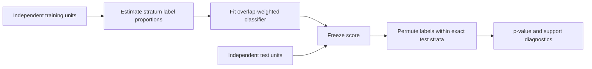

# Training Scores for Conditional Audits
### Overlap Weighting and Power under Confounding

**Can the training objective hide the conditional signal we later want to test?**

A classifier trained for marginal prediction can exploit confounders and compress away useful within-group differences. This work applies established overlap weights during score training, freezes the learned score, and evaluates it with an independent within-stratum permutation test.

[Start with the code](conditional_audit.py) · [Run the example](demo.py) · [Provenance](PROVENANCE.md)



## Algorithmic idea

For each prespecified training stratum `z`, estimate `e(z) = mean(Y | z)`. A positive observation gets weight `1 − e(z)`; a negative observation gets weight `e(z)`. Normalize weights to mean one. Each mixed-label stratum then contributes equal total positive and negative weight. Pure-label strata receive zero weight; if no overlap remains, fitting stops.

The independent audit holds scores fixed and permutes test labels within exact strata. It uses a one-sided rank statistic, midranks for ties, and the Monte Carlo correction `(1 + exceedances)/(B + 1)`.

**The contribution is the use and evaluation of overlap weighting for score construction in conditional audits. Overlap weighting itself is established methodology.**

## Paper result

In the paper's fresh 500-seed alternative block, forest detection power rises from **61.6% to 79.4%**, a paired gain of **17.8 percentage points [13.4, 22.4]**. Its reported null rejection rate is **4.0%**. These are paper-reported results; the small example here does not regenerate those values.

## Explore in five minutes

```bash
git clone https://github.com/cenacchi2000/Training-Scores-for-Conditional-Audits.git
cd Training-Scores-for-Conditional-Audits
python -m venv .venv
source .venv/bin/activate
pip install -r requirements.txt
python demo.py
python -m unittest discover -s tests -v
```

The demo prints marginal AUROC, a conditional p-value, mixed-stratum counts, and within-stratum test information for ordinary and overlap-weighted forests. A single simulated dataset is illustrative; it cannot establish a power advantage.

| Read | What to inspect |
|---|---|
| [`overlap_weights`](conditional_audit.py) | Train-only empirical proportions, class balance, zero-overlap handling |
| [`permutation_test`](conditional_audit.py) | Frozen ranks, exact strata, plus-one correction, support diagnostics |
| [`demo.py`](demo.py) | Independent samples and matched learners/randomizations |
| [`tests/`](tests) | Balance and uninformative-stratum checks |

## Possible use in surveillance research

A future study could ask whether a surveillance-derived score retains signal within declared comparable groups. The weighting objective offers a way to train for that question. Epidemic time series require a separately justified temporal or geographic randomization scheme: these independent-unit examples do not supply one. Coarse bins do not automatically remove continuous confounding.

## Release scope

This is a **new reference implementation based on Equations 6–8 of the supplied manuscript**, prepared for code exploration. The original training grid, permutation banks, and 500-seed records were not recovered. This repository does not claim full paper reproduction or validated epidemic forecasting.

Related work: [Predictive-gain audits](https://github.com/cenacchi2000/Predictive-Gain-Audits) · [Counterfactual fragility](https://github.com/cenacchi2000/Counterfactual-Fragility-Certificates)
